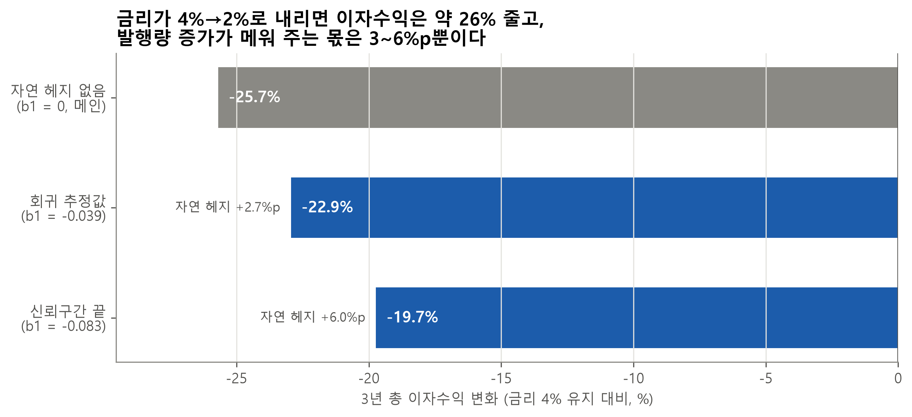
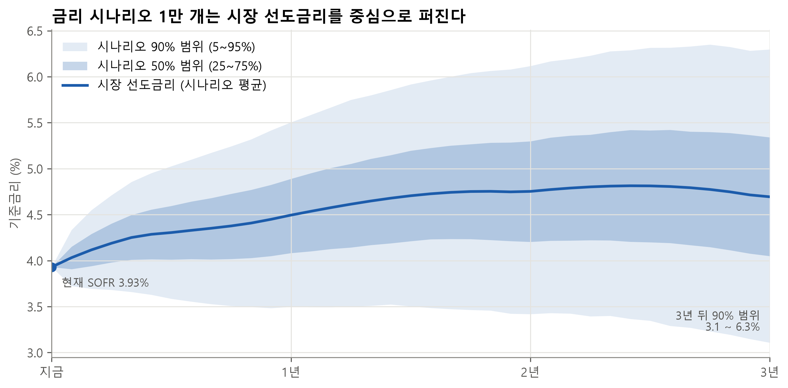
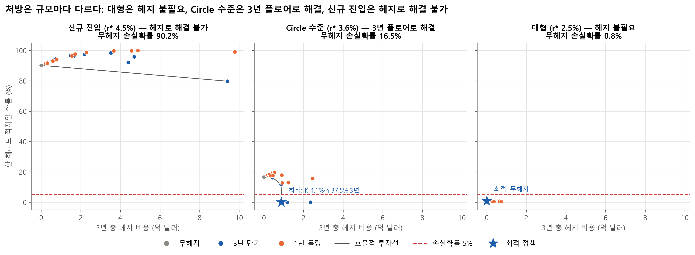
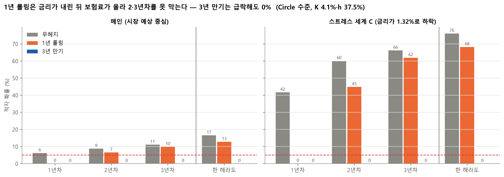
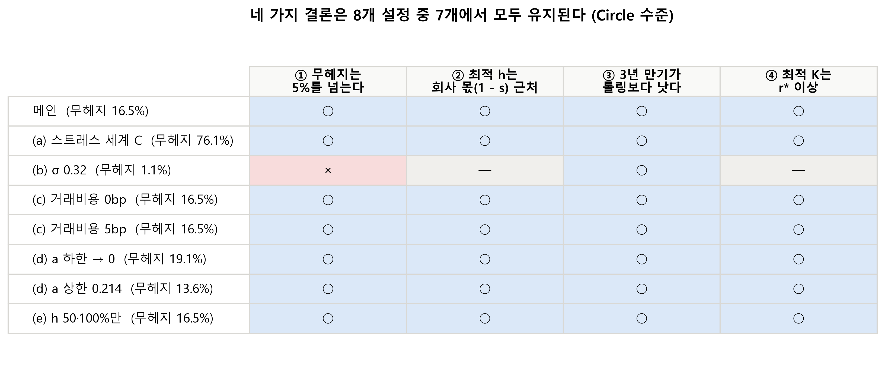

# 스테이블코인 발행사의 금리 위험과 플로어 운용 전략

> 발제안 「디지털 자산의 제도화와 국내 기업의 대응 전략」 — 금융공학 파트
> 데이터 기준일: 2026-10-26 (SOFR 3.93%), Circle 재무제표 2025-Q3 ~ 2026-Q2

---

## 1. 요약

1. **스테이블코인 발행사는 보유자에게 이자를 줄 수 없어(GENIUS Act), 금리 하락이 곧 적자 위험이다.**
2. **금리가 내리면 발행량이 늘지만, 그 자연 헤지는 너무 작다.** 3년간 금리가 4% → 2%로 내리면 이자수익은 약 26% 줄고, 발행량 증가가 메워 주는 몫은 3~6%p뿐이다.
3. **헤지를 한다면 방법은 분명하다: 손익분기보다 살짝 위의 행사가, 발행사 몫(1 − s)만큼의 명목금액, 3년 만기로 한 번에.** 1년 롤링은 금리가 내린 뒤 보험료가 올라 효과가 크게 떨어진다(손실확률 12.7% vs 0%).
4. **처방은 규모마다 다르다.** 대형은 헤지가 필요 없고, Circle 수준은 헤지로 해결되며, **신규 진입자는 예정된 적자라 헤지로 해결할 수 없다 → 제휴·비용 공유·성장이 먼저다.** 국내 기업은 진입 초기에 신규 진입 구간에 놓인다.

**방법론 (발표용)**
> 시장 금리 기대를 중심으로 과거 변동성을 반영한 몬테카를로 시뮬레이션으로 최적 헤지 정책을 도출했다. 결과는 가정에 조건부이므로 주요 가정을 바꿔가며 핵심 결론의 강건성을 점검했고, 데이터로 추정한 관계 중 통계적으로 불확실한 것(발행량과 금리의 관계)은 가장 보수적인 값으로 가정했다.

---

## 2. 문제: 발행사의 수익 구조와 금리 하락 위험

**수익 구조**
- 발행사는 스테이블코인 1달러를 발행할 때마다 1달러를 준비금(주로 단기 국채·환매조건부채권)으로 보관하고, 그 **이자**로 돈을 번다.
- GENIUS Act는 보유자에게 이자 지급을 금지한다. 그래서 이자는 발행사가 갖지만, 그중 상당 부분을 유통 파트너에게 나눠 준다. Circle은 준비금 이자의 **약 62.5%(s)**를 Coinbase 등에 지급한다.
- 발행사 이익 ≈ (1 − s) × 금리 × 준비금 − 고정비

**손익분기 금리 r\***

$$r^* = \frac{C}{(1 - s)\,R}$$

- C = 연간 고정비, s = 배분율, R = 준비금(= 발행량)
- **직관**: 고정비를 발행사 몫의 준비금으로 나눈 값. 금리가 이보다 낮으면 적자다. **규모(R)가 작을수록 r\*가 높다.** 같은 고정비를 적은 준비금으로 벌어야 하기 때문이다.
- Circle: C = 9.62억 달러/년, s = 0.625, R ≈ 712억 달러 → **r\* ≈ 3.6%**. 현재 SOFR(3.93%)와 거리가 가깝다.

**금리 하락 위험**
- 수익이 거의 전부 준비금 이자이므로, 금리가 r\* 아래로 내려가면 바로 적자가 된다.
- 금리가 내리면 사람들이 스테이블코인을 더 보유해 발행량이 늘 수 있다(**자연 헤지**). 하지만 데이터로 추정한 효과는 작고 통계적으로도 불확실하다(추정값 b1 = −0.039, p ≈ 0.08).

---

## 3. 방법

**한 문장 요약**: 시장이 예상하는 금리를 중심으로 금리 시나리오 1만 개를 만들고, 규모가 다른 발행사 3곳이 각각 25가지 헤지 전략을 썼을 때 **3년 중 한 해라도 적자가 날 확률**과 **헤지 비용**을 비교했다.

| 구성 | 내용 |
|---|---|
| 금리 시나리오 | 미국채 수익률곡선에서 뽑은 **시장 선도금리**를 중심으로, 과거 금리 변동성(σ 0.64%p/√년)만큼 퍼지는 경로 1만 개 (월간 36개월). 경로 평균 = 선도금리 |
| 수익률곡선 | 미국채 곡선에서 1개월 국채 − SOFR 차이(18bp)를 빼 SOFR 기준으로 맞추고, 만기 사이를 부드럽게 연결(PCHIP 보간) |
| 발행사 3곳 | 고정비·배분율은 Circle과 같고 준비금만 다름: **신규 진입**(r\* 4.5%, 570억 달러), **Circle 수준**(r\* 3.6%, 712억 달러), **대형**(r\* 2.5%, 1,026억 달러) |
| 발행량 | 3년간 고정 (성장 없음, 금리에 반응하지 않음 = 가장 보수적) |
| 준비금 수익률 | max(금리, 0) − 0.15%p (Circle 공시로 확인한 실제 차이) |
| 헤지 수단 | **금리 플로어**: 금리가 행사가 K 아래로 내리면 그 차이를 받는 보험. 가격은 바슐리에(정규) 모형, 시나리오와 같은 변동성 사용 |
| 전략 25개 | 무헤지 + 행사가 4개(r\* − 1%, − 0.5%, r\*, + 0.5%) × 헤지 비율 3개(37.5%, 50%, 100%) × 만기 2개(1년 롤링, 3년) |
| 거래비용 | 명목금액의 연 2bp |
| 평가 기준 | 3년 중 한 해라도 적자일 확률 ≤ 5%를 만족하는 전략 중 **총 헤지 비용(보험료 + 거래비용)이 가장 작은 것** = 최적 정책 |

- 지금 시장 선도금리는 3.93% → 약 4.7%로 **오르는** 모양이다. 3년 뒤 금리의 90% 범위는 약 3.1~6.3%다.

---

## 4. 결과

### 4-1. 규모별 처방

| 규모 | 준비금 | 무헤지 손실확률 | 최적 정책 | 손실확률 | 3년 비용 |
|---|---|---|---|---|---|
| 신규 진입 (r\* 4.5%) | 570억 달러 | **90.2%** | **없음** (가장 낮은 전략도 79.8%) | — | — |
| Circle 수준 (r\* 3.6%) | 712억 달러 | **16.5%** | **K 4.1%·h 37.5%·3년** | **0.0%** | **0.88억 달러** (보험료 0.72억 + 거래비용 0.16억), 준비금의 연 약 4bp |
| 대형 (r\* 2.5%) | 1,026억 달러 | 0.8% | 무헤지 | 0.8% | 0 |

- **대형**: 금리가 손익분기점까지 내려갈 가능성이 매우 낮아 헤지가 필요 없다.
- **Circle 수준**: 무헤지로는 6번 중 1번꼴로 적자 연도가 생긴다. 준비금의 연 4bp 비용으로 이 위험을 사실상 없앨 수 있다.
- **신규 진입**: 손익분기점(4.65%)이 지금 시장 금리보다 높아서 **적자가 "드문 위험"이 아니라 "예상되는 결과"**다. 플로어는 공정한 가격의 보험이라 평균 손익을 올려 주지 못한다. 가장 비싼 전략(준비금의 연 55bp)을 써도 손실확률이 80%다.
  - 참고: 발행량이 연 30%씩 성장한다면 신규 진입자도 K 4.5%·h 37.5%·3년으로 5%를 맞출 수 있다. **성장이 먼저**라는 뜻이다.

### 4-2. 최적 운용 3원칙 (Circle 수준 기준)

1. **행사가: 손익분기보다 살짝 위.** 준비금 수익률이 금리보다 0.15%p 낮아 실제 손익분기점은 r\* + 0.15%p(3.75%)다. K가 r\* 이하이면 그 사이의 하락을 막지 못한다(K 3.6%·h 100%·3년도 11.8%).
2. **명목금액: 발행사 몫(1 − s)만큼.** 발행사는 이자의 37.5%만 가지므로, 금리 1%p 하락 시 손실도 준비금의 0.375%다. h 37.5%면 정확히 맞고, h 50%·100%는 같은 보호를 더 비싸게 산다(h 50%: 1.18억 달러, 약 33% 더 비쌈).
3. **만기: 3년으로 한 번에.** 아래 4-3.

### 4-3. 1년 롤링 vs 3년 만기

| Circle 수준, K 4.1%·h 37.5% | 1년차 | 2년차 | 3년차 | 한 해라도 적자 |
|---|---|---|---|---|
| 무헤지 | 6.1% | 8.7% | 11.1% | 16.5% |
| 1년 롤링 | 0.0% | 6.5% | 9.8% | **12.7%** |
| 3년 만기 | 0.0% | 0.0% | 0.0% | **0.0%** |

- **1년 롤링은 1년차만 막는다.** 금리가 이미 내린 뒤 다시 사면 그만큼 보험료가 올라 보호 효과를 상쇄한다. 불이 난 뒤에 화재보험을 새로 드는 것과 같다.
- **3년 만기는 지금 가격으로 3년 보호를 고정**한다. 금리가 1.32%로 끌려 내려가는 스트레스 상황(세계 C)에서도 3년 만기는 0%, 롤링은 68.2%, 무헤지는 76.1%다.
- 보험료도 3년 만기가 롤링보다 약 5~10% 싸다.

---

## 5. 강건성

**네 가지 결론은 8개 설정 중 7개에서 유지된다.**

| 점검한 결론 (Circle 수준) |
|---|
| ① 무헤지는 손실확률 5%를 넘는다 |
| ② 최적 헤지 비율은 회사 몫(1 − s) 근처다 |
| ③ 3년 만기가 1년 롤링보다 손실확률이 낮다 |
| ④ 최적 행사가는 손익분기 r\* 이상이다 |

- **시뮬레이션 오차**: 무헤지 16.5%의 95% 신뢰구간은 15.8~17.3%다. 롤링 − 3년 차이 12.7%p의 신뢰구간은 12.1~13.4%p다. 난수 시드를 5번 바꿔도 최적 전략은 같다.
- **뒤집히는 설정은 하나**: 금리 변동성을 최근 3년 수준(σ 0.32)으로 낮추면 무헤지 손실확률이 1.1%가 되어 **헤지가 필요 없어진다**(① ×). 그때도 "3년 만기가 롤링보다 낫다"(③)는 유지된다.
  - → "헤지가 꼭 필요한가"는 **변동성 전망에 달려 있다.** 다만 금리 급락은 예측하기 어렵고(2008, 2020), 3년 플로어는 시장이 예상하지 못한 하락(세계 C)까지 막는다.
- **파라미터 불확실성**: 금리의 평균회귀 속도 a는 95% 신뢰구간이 0을 포함한다(평균으로 돌아온다는 것을 확신할 수 없음). 그러나 a = 0과 상한에서도 결론이 같다.

---

## 6. 한계 (자세한 내용: `limitations.md`)

| 한계 | 결론을 치우치게 하는 방향 |
|---|---|
| 금리 충격을 정규분포로 가정 (실제는 꼬리가 두꺼움) | 급락 위험 과소 → **헤지 필요성 과소평가** |
| 선도금리를 기대 경로로 사용 (기간 프리미엄 미반영) | 하락 위험 과소 → **헤지 필요성 과소평가** |
| 국채 곡선으로 SOFR 곡선 대용, 18bp 차이 일정 | 플로어 비용 **과소평가** 가능 |
| 거래상대방·유동성 (Circle 수준 명목 약 267억 달러) | 비용 **과소평가** |
| 발행량이 금리에 반응하지 않는다고 가정 (b1 = 0) | 자연 헤지 무시 → **보수적** |
| 1요인 금리 모형, 가격 σ = 모형 등가 σ, 거래비용 2bp 가정 | 불확실 (거래비용 0~5bp에서는 결론 유지) |
| C·s는 최근 4개 분기 회계값, Coinbase 계약 재협상 시 s 변동 | s ↑ → r\* ↑ → 헤지 필요성 ↑ |
| **규제**: GENIUS Act에서 발행사의 법인 차원 금리 파생상품 거래 허용 여부 확인 필요. 준비금은 담보 제공·처분 제한 → 플로어는 자기자본으로 매입한다는 전제 | 허용되지 않으면 처방 자체가 불가 |

- 정리: 한계의 대부분은 **위험과 비용을 작게 보는 방향**이다. 실제 헤지 필요성은 이 분석보다 클 수 있다.

---

## 7. 국내 기업에 주는 시사점

- **진입 초기에는 신규 진입 구간에 놓인다.** 원화·달러 스테이블코인을 새로 발행하는 국내 기업은 처음에 준비금이 작아 손익분기 금리가 시장 금리보다 높을 가능성이 크다. 이 구간의 적자는 **금리 헤지로 해결되지 않는다.**
- **직접 발행보다 제휴로 고정비를 나눠라.** 컨소시엄을 만들거나, 기존 발행사와 협업해 브랜드만 붙이는 **화이트라벨 모델**(외부 발행사가 발행·준비금 관리를 맡고 국내 기업은 유통과 브랜드를 맡는 방식)로 고정비를 공유하면 r\*를 낮출 수 있다.
- **규모를 확보한 뒤에는 3년 플로어로 헤지하라.** r\*가 시장 금리 아래로 내려와 Circle 수준이 되면, 손익분기보다 살짝 위의 행사가·발행사 몫만큼의 명목·3년 만기 플로어로 적은 비용(준비금의 연 수 bp)에 금리 하락 위험을 막을 수 있다.
- **은행에게는 수수료 기회다.** 발행사는 금리 플로어의 자연스러운 수요자다. 은행은 준비금 수탁과 함께 발행사 맞춤형 헤지 상품을 공급하는 역할로 수수료 수익을 얻을 수 있다.

---

## 8. 부록: 분석 설정의 변경 이력

### 1차 설정과 결과

| 항목 | 1차 설정 |
|---|---|
| 발행량 성장률 | 최근 24개월 평균 (연 약 30%) — 3년간 준비금 2.2배 |
| 규모 | r\* 기준 소형 3.9% / 중형 2.5% / 대형 1.5% |
| 행사가 | 모든 규모에 고정 2.0, 2.5, 3.0, 3.5% |
| 헤지 비율 | 50, 100% |
| 평가 지표 | 3년 누적 손익 < 0 인 경로 비율 |
| 준비금 수익률 | max(금리, 0) |

**1차 결과**: 세 규모 모두 무헤지 손실확률이 0.03% 이하여서, 모든 규모에서 무헤지가 최적이었다. 효율적 투자선이 사실상 한 점으로 줄어 전략 비교가 성립하지 않았다. 원인을 진단해 보니, 성장률을 0으로 두면 소형의 손실확률이 11.8%로 뛰었다. 또 고정 행사가(최대 3.5%)가 소형의 r\*(3.9%)보다 낮아 어떤 전략도 5%에 닿지 못했다.

### 무엇을 왜 바꿨나

| 항목 | 1차 | 최종 | 바꾼 이유 |
|---|---|---|---|
| 성장률 | 연 30% | **0** (연 30%는 비교용) | 손실확률은 성장이 멈춘 경우에도 버티는지를 봐야 한다. 최근 24개월은 금리 인하기와 GENIUS Act가 겹친 특수 시기였고, 1차에서는 성장 가정이 금리 위험을 가렸다 |
| 규모 정의 | r\* 3.9 / 2.5 / 1.5% | **4.5 / 3.6 / 2.5%** | 실제 Circle의 r\*(3.6%)를 기준점으로 삼고, 손익분기점이 시장 금리보다 높은 신규 진입자를 넣어 규모 효과를 보이기 위해 |
| 행사가 | 고정 2.0~3.5% | **규모별 r\* 기준** | 행사가가 손익분기점보다 낮으면 손익분기 근처의 하락을 막을 수 없다. 각 발행사의 손익분기점 기준으로 정해야 비교가 공정하다 |
| 평가 지표 | 3년 누적 | **한 해라도 연간 적자** | 누적 손익은 초반 이익이 뒤의 손실을 덮어 위험을 작게 보이게 한다(Circle 수준: 누적 7.2% vs 한 해라도 16.5%) |
| 준비금 수익률 | max(r, 0) | **max(r, 0) − 0.15%p** | Circle 공시로 계산한 실제 준비금 수익률이 9개 분기 모두 기준금리보다 0.1~0.2%p 낮았다 |
| 헤지 비율 | 50, 100% | **37.5(= 1 − s), 50, 100%** | 발행사 몫만큼의 명목이 같은 보호를 약 25% 싸게 준다는 것을 강건성 점검에서 확인했다 |

### 그 이전 단계에서 바꾼 것
- **금리 시나리오**: 과거 데이터로 추정한 Vasicek 모형(장기 평균 FOMC 3.2% / 스트레스 1.32%) → **시장 일치 모형**(경로 평균 = 선도금리). 시나리오와 플로어 가격의 기준을 일치시키기 위해서다. 스트레스 1.32%는 강건성 점검의 "세계 C"로 남겼다.
- **수익률곡선**: 국채 곡선 그대로 → 1개월 국채 − SOFR 차이(18bp) 차감 + PCHIP 보간.
- **플로어 가격의 변동성**: 0.64 고정 → 평균회귀를 반영한 등가 σ(시나리오와 같은 퍼짐).
- **발행량과 금리의 관계**: 회귀 추정값 b1 = −0.039(p ≈ 0.08) 대신 가장 보수적인 0.

---

*데이터: FRED(SOFR, 미국채 수익률, FOMC 전망, 비트코인), DefiLlama(스테이블코인 유통량), SEC EDGAR(Circle 재무제표). 분석 코드: `notebooks/01~07`.*
